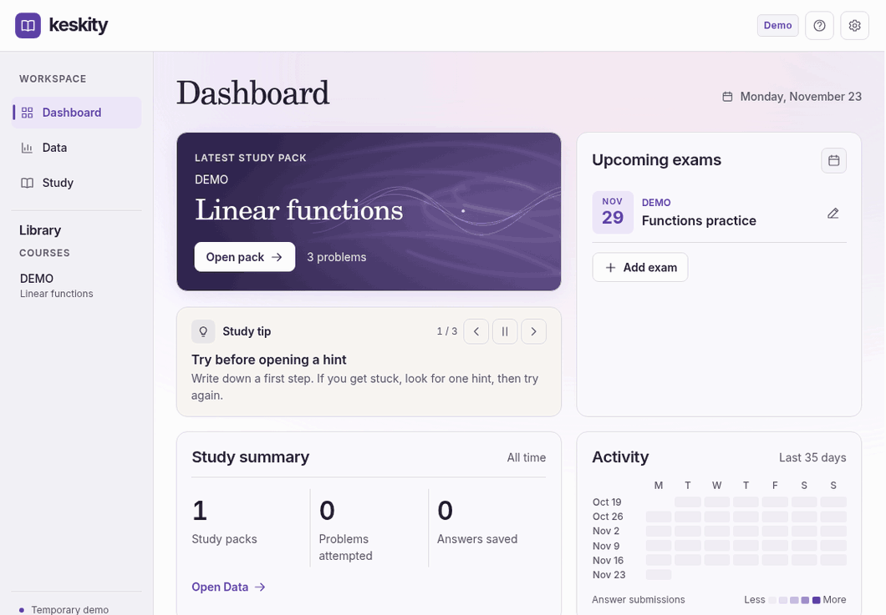
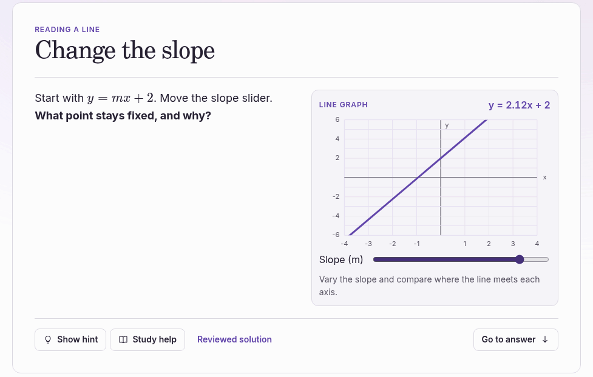
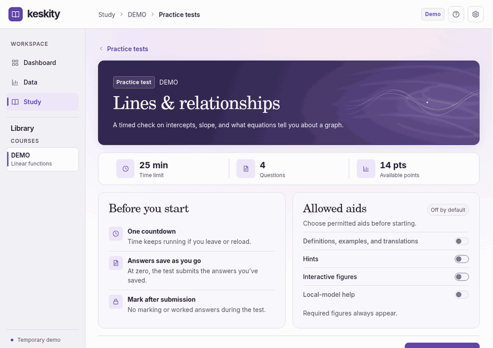
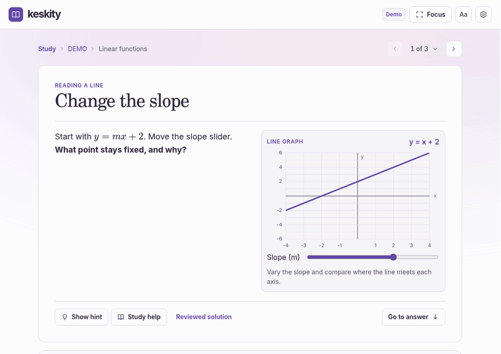

# keskity

keskity is a local study workspace for reviewed problem sets, timed practice tests, and private practice history. Use Pi and Obsidian to author packs, then import them into keskity to study.

[Try the demo](#try-the-demo) · [See it in action](#see-it-in-action) · [Author a pack](PACKS.md) · [Build 10 notes](design/build-10/README.md)

## Try the demo

You’ll need Python 3.11+, npm, and the `problem-sets` validator from the pack authoring workflow. The app looks for the validator at `~/.agents/skills/problem-sets/scripts/problem_sets.py`. To use another copy, pass `--validator /path/to/problem_sets.py` before `serve`.

From the repository directory, install the frontend dependencies and start the demo.

```sh
npm ci --ignore-scripts
python3 -B hub.py serve --demo --port 8767
```

Open [http://127.0.0.1:8767](http://127.0.0.1:8767). Try **Study → DEMO → Change the slope** or **Study → Practice tests → Lines & relationships**. Both work with the local model off. Stopping the demo discards its study records.

## See it in action

### Study from the dashboard

Open a course overview, browse its problem cards, and use a slider to explore how slope changes a line while its intercept holds steady.



### Look up a term in place

Select a term in an untimed problem to open **Explain**, **Definition**, and **Translation** beside it. View a pack’s reviewed definition, example, or translation. The **Study help** button also lets you choose a term or passage with the keyboard. [Build 08 walkthrough](design/build-08/README.md)



### Take and review a timed practice test

Review the rules, start the timer, and answer questions as keskity saves your work. After submitting, review choice scores and use the pack’s rubric to mark written answers. [Timed practice test walkthrough](design/build-04/README.md)



### Check the model and request an explanation

Open **Settings → Local model** to check the connection. A local explanation appears inside Study help as the reply arrives. The GIF uses simulated model responses to show the connection states and streaming at a readable pace. [Model readiness](design/build-10/README.md) · [Streaming replies](design/build-09/README.md)



## Study with your own packs

Follow the [pack authoring guide](PACKS.md#first-pack-author-check-import) to publish a reviewed pack. Start the regular workspace with:

```sh
python3 -B hub.py serve
```

Open [http://127.0.0.1:8765](http://127.0.0.1:8765), choose **Import**, and select the published folder containing `set.json` and any `assets/`. For an image-free pack, you can select `set.json` by itself. Identical imports are deduplicated. Changed editions keep separate histories.

You can also validate or import a pack from the terminal.

```sh
python3 -B hub.py check /path/to/published
python3 -B hub.py import /path/to/published
```

- **Dashboard** resumes your last opened problem in this browser and shows exam dates you enter. Use a matching course code to link an exam to imported packs.
- **Study** groups material by course or independent pack. Group problem cards by topic or pack and filter by progress. **Data** summarizes attempts and shows 35 days of submissions, including retries.
- **Save draft** keeps an unfinished answer for that problem and edition. **Submit answer** records an attempt and clears the draft. Submitted attempts count toward progress and can be exported.
- **Attempt history** records the problem version, answer, time, and help used. Use **Export selected for Pi** to download the attempts you want to review. Your Obsidian vault remains the source for notes and learning records.
- **Aa** adjusts reading font, size, spacing, and line width. **Settings → Appearance** controls the theme, glow, and fonts for the interface and titles.

### Timed test behavior

Permitted aids start off. The countdown keeps running when you reload or leave. At zero, keskity submits the answers saved before the deadline. If you finish early, keskity lists any unanswered questions for review before you confirm.

Choice answers use the pack’s key. Written answers stay **Pending** until you mark them with the rubric or request eligible local-model marking. Model marks carry a **Provisional** label. The percentage appears once marking is complete, and a grade appears when the pack supplies a scale. Use **Previous attempts** to review earlier results and **Export this attempt** to download a selected result for Pi.

### Try the demo from your phone

With both devices on the same network, find your PC’s IPv4 address with `ip -br -4 addr` on Linux and substitute it below.

```sh
python3 -B hub.py serve --demo --lan-ip 192.168.1.42 --port 8767
```

Open the printed HTTP address on your phone. This serves the temporary demo over the LAN. Local-model actions are available from the host computer in the loopback demo.

## Optional local model

Run `llama-server` with an existing compatible GGUF to enable advisory feedback and additional Study help. Start the grader and app in separate terminals.

```sh
sh start-grader.sh
```

```sh
python3 -B hub.py serve --grader-port 8766
```

The grader script defaults to `~/models/Qwen3-8B-Q4_K_M.gguf`. Set `STUDY_HUB_MODEL` to use another compatible file. If you set `STUDY_HUB_GRADER_PORT`, pass the same port to `serve`. Add `--demo --port 8767` to try the model with the sample packs.

- **Settings → Local model** shows **Off**, **Starting**, **Ready**, or **Unavailable**. Open the panel or choose **Check again** to refresh the status.
- **Study help** can explain, define, or translate selected text in overviews and in untimed problems that opt in. **Ask further** opens below a reviewed note when the pack allows it. The app marks generated replies **Unreviewed** and discards them when you leave.
- **Copy explanation prompt** previews the text for your clipboard. In an overview, you can choose whether to include the surrounding passage. Copying works with the model off.
- **Written feedback** is available for eligible submitted answers. You can save an attempt with the model off and ask for feedback later from its history. In a submitted timed test, open a pending text-only answer and choose **Mark with local model**.
- **Reduced motion** shows the completed model reply at once. Test scores update after the mark is complete.

Read about model inputs, streaming, and storage in the [local model guide](MODEL.md).

## Local data and development

The app and grader default to loopback addresses. Your regular workspace stores attempts, answers, drafts, and marks in an unencrypted SQLite database at `~/.local/share/study-hub/study.db` or `$XDG_DATA_HOME/study-hub/study.db`. Stop the app before backing up the database. Pass `--data-dir /path/to/workspace` before `serve` to open a separate workspace. Appearance preferences, uploaded fonts, and the last translation language stay in the browser for that app address.

The backend uses Python’s standard library. The frontend lives in `web/` and loads Markdown-it and KaTeX locally.

```sh
python3 -B -m unittest discover -s tests -v
node tests/smoke_browser.mjs
```

The browser test uses local Chromium, Node 22+, and fictional study data. Set `STUDY_HUB_SCREENSHOTS` to an output folder to save screenshots. Set `STUDY_HUB_TEST_GRADER_PORT=8766` to exercise an already-running local model.

[Pack formats and authoring](PACKS.md) · [Local model details](MODEL.md) · [Roadmap](ROADMAP.md)
