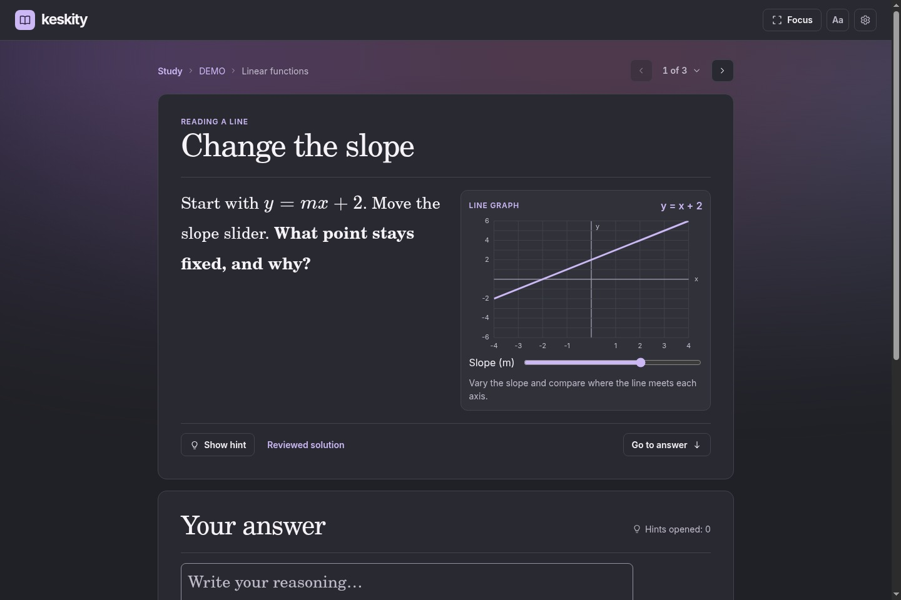
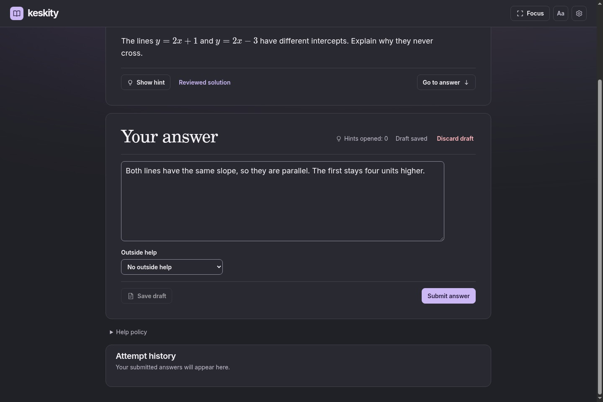

# keskity

A local study workspace for opening reviewed problem sets, working through them one at a time, and keeping a private practice history. Use Pi and Obsidian to plan and author material, then bring published packs into keskity.

[Try the demo](#try-the-demo) · [Author a pack](PACKS.md) · [Roadmap](ROADMAP.md)

## Build 03 preview

[](design/build-03/problem-light.jpg)

| Graphite with larger reading text | Restored answer draft |
| --- | --- |
| [](design/build-03/problem-dark.jpg) | [](design/build-03/answer-draft.jpg) |

[See the full Build 03 gallery, including Focus mode, mobile, and typography settings.](design/build-03/README.md)

## Try the demo

You’ll need **Python 3.11+**, **npm**, and the **`problem-sets` validator** from the pack authoring workflow. The app expects the validator at `~/.agents/skills/problem-sets/scripts/problem_sets.py`. If yours is elsewhere, pass `--validator /path/to/problem_sets.py` before `serve`. The demo uses the same validator as regular imports.

Run these commands from the repository directory to install the frontend dependencies and start the demo.

```sh
npm ci --ignore-scripts
python3 -B hub.py serve --demo --port 8767
```

Open [http://127.0.0.1:8767](http://127.0.0.1:8767), choose **Open pack**, and try the slope slider in **Linear functions**. In the problem view, **Focus** hides navigation and history. Press **Escape** to leave it. **Aa** adjusts the reading font, size, spacing, and line width. **Settings → Appearance** controls the theme, glow, and separate interface and title fonts. Demo study records are discarded on exit.

## Study with your own packs

```sh
python3 -B hub.py serve
```

Open [http://127.0.0.1:8765](http://127.0.0.1:8765). Choose **Import** and select the published folder containing `set.json` and any `assets/`. For an image-free pack, you can select `set.json` by itself. Identical imports are deduplicated, and changed editions keep separate histories. See the [pack authoring guide](PACKS.md) for overviews, problem labels, interactive graphs, and multiple-choice keys.

- **Dashboard** resumes the last problem opened in this browser and shows exam dates you enter. An exam’s course code links it to imported packs.
- **Study** shows course and pack overviews, progress, and sortable, filterable problem cards. **Data** summarizes attempts and recent activity. **Attempted** means you submitted at least one answer to a checked problem in that edition. The 35-day activity calendar counts submissions, including retries.
- **Save draft** stores an unfinished response for that problem and pack edition. It comes back when you reopen the problem. **Submit answer** records an attempt and clears the saved draft. Drafts are excluded from progress and exports.
- **Attempt history** records the problem version, answer, time, and help used. Choose **Export selected for Pi** to download the attempts you want to review with Pi. Your Obsidian vault stays the source for notes and learning records.

Use `check` to validate a pack and `import` to add it to your workspace.

```sh
python3 -B hub.py check /path/to/published
python3 -B hub.py import /path/to/published
```

## Optional local feedback

Multiple-choice questions use the reviewed answer key. For eligible written responses, you can enable advisory feedback with `llama-server` and an existing Qwen3 GGUF. Start the grader and app in separate terminals.

```sh
sh start-grader.sh
```

```sh
python3 -B hub.py serve --grader-port 8766
```

The script defaults to `~/models/Qwen3-8B-Q4_K_M.gguf`. Set `STUDY_HUB_MODEL` to use another compatible local model. If you change `STUDY_HUB_GRADER_PORT`, pass the same port to `serve`. The grader receives the submission, problem statement, language, and reviewed key. Feedback is provisional. You can submit even if the model is unavailable, and request a check later from attempt history.

## Local data and development

The app and optional grader listen on `127.0.0.1`. Attempts, drafts, and feedback are stored in an unencrypted SQLite database at `~/.local/share/study-hub/study.db` or `$XDG_DATA_HOME/study-hub/study.db`. Stop the app before backing up the database. Use `--data-dir /path/to/workspace` before `serve` to open a separate workspace. Appearance preferences and uploaded font files stay in the browser for that local app address.

`hub.py` serves the app, `packs.py` adapts reviewed packets, and `store.py` handles SQLite state. The backend uses Python’s standard library. The frontend is in `web/` and uses local copies of Markdown-it and KaTeX.

```sh
python3 -B -m unittest discover -s tests -v
node tests/smoke_browser.mjs
```

The browser smoke test uses local Chromium, Node 22+, and fictional study data. Set `STUDY_HUB_SCREENSHOTS` to an output folder to save screenshots during the run. Set `STUDY_HUB_TEST_GRADER_PORT=8766` to include an already-running local model.
