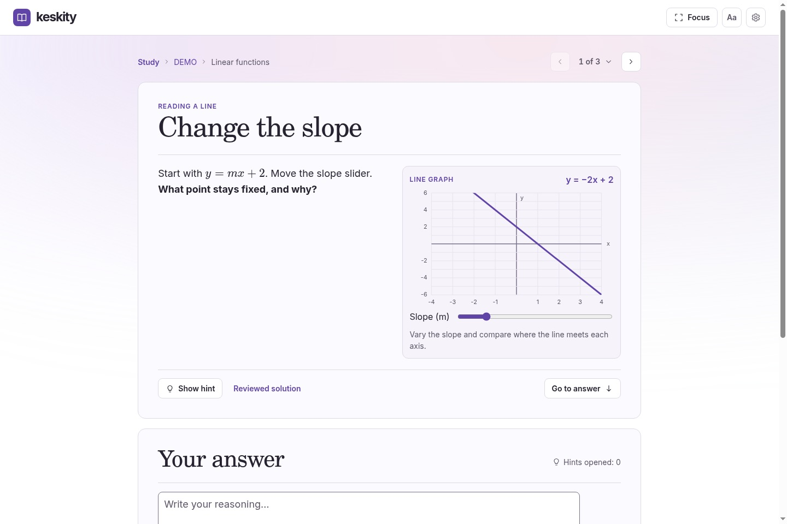
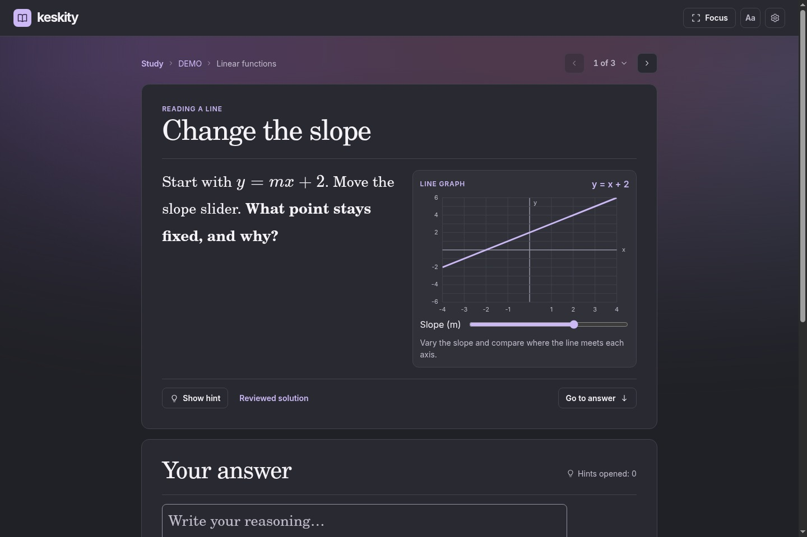
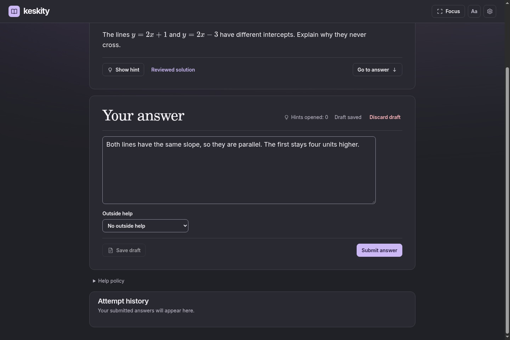
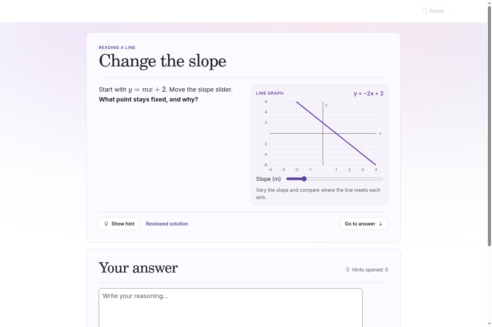
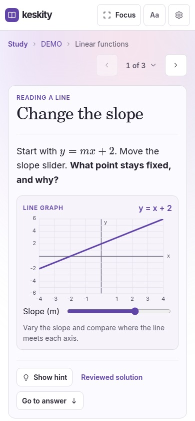
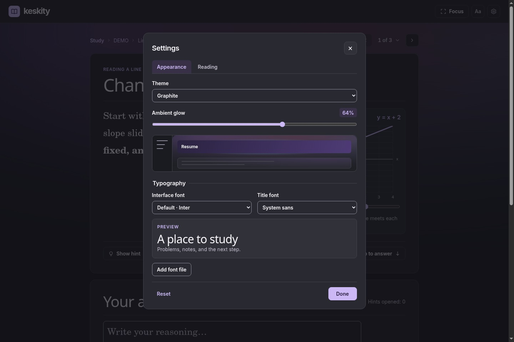

# Build 03 · Problem view and typography

Screenshots from the **Linear functions** demo.

| Problem · White · Violet | Problem · Graphite |
| --- | --- |
|  |  |
| **Restored draft** | **Focus mode** |
|  |  |
| **Mobile problem view** | **Typography settings** |
|  |  |

[Demo setup and usage](../../README.md#try-the-demo)

## What’s in Build 03

- **Problem view.** The prompt and graph sit side by side on desktop and stack on narrow screens. Use the arrows or the problem counter to switch problems. **Go to answer** takes you to the editor.
- **Focus.** Hide navigation and history while you work on your answer. Press **Escape** to exit.
- **Drafts.** Choose **Save draft** to keep one draft per problem edition. It restores on reopening. **Submit answer** records an attempt and clears the saved draft. **Discard draft** removes it without submitting. Drafts are excluded from progress and local feedback.
- **Appearance.** Set **Interface font** and **Title font** independently. The title choice also affects featured headings such as Resume and Problems. Choose a preset, name an installed font, or add a local font file. **Aa** controls the reading text separately.

