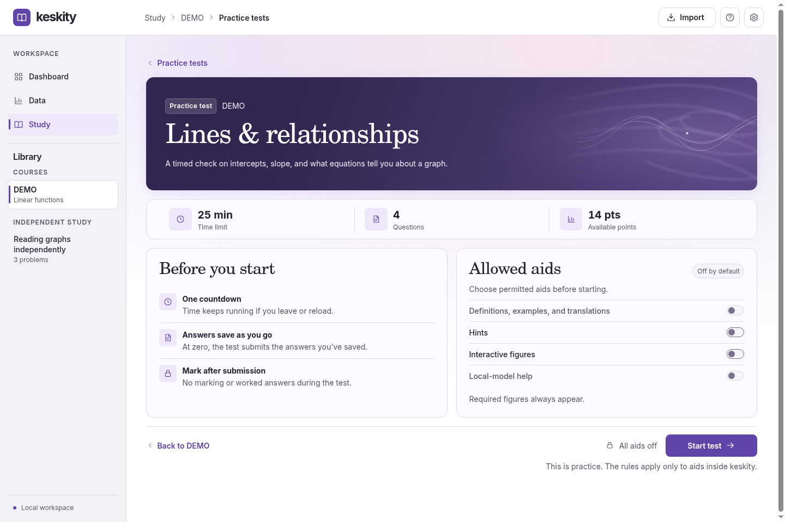
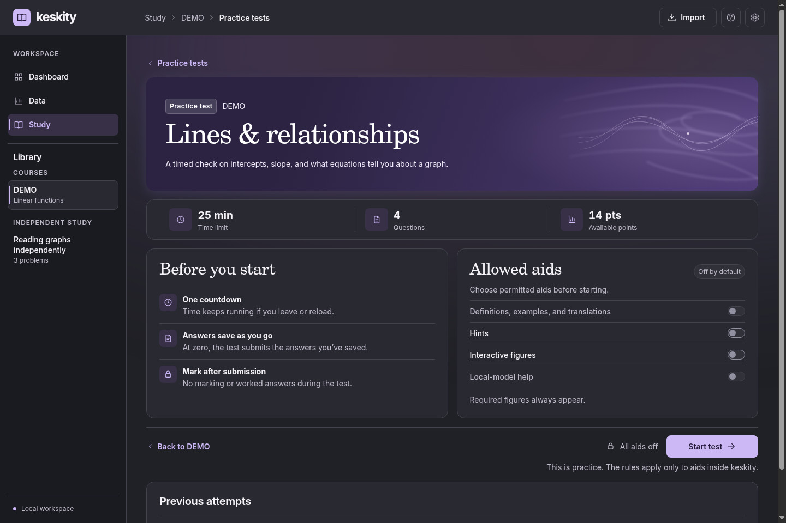
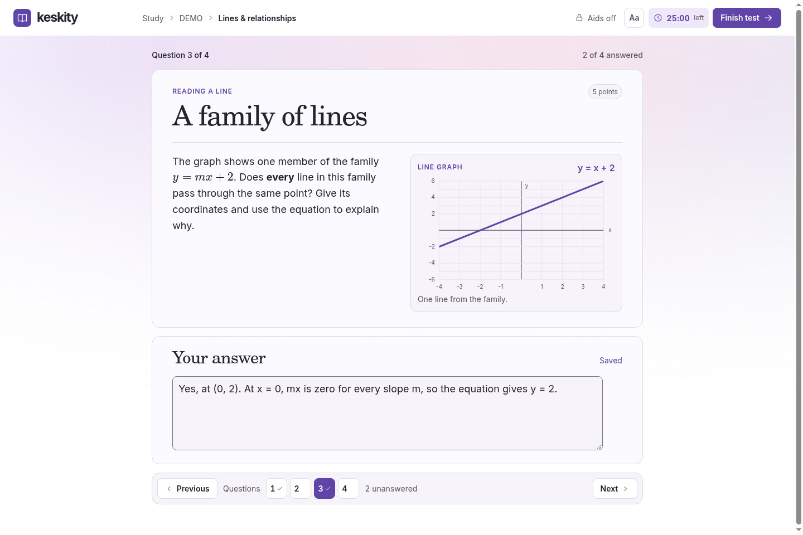
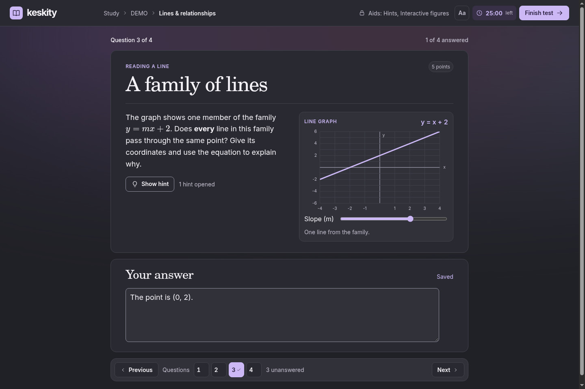
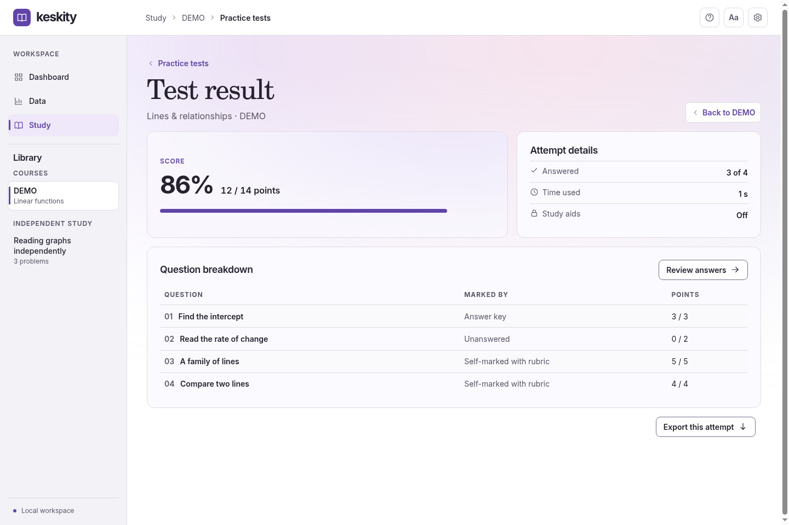
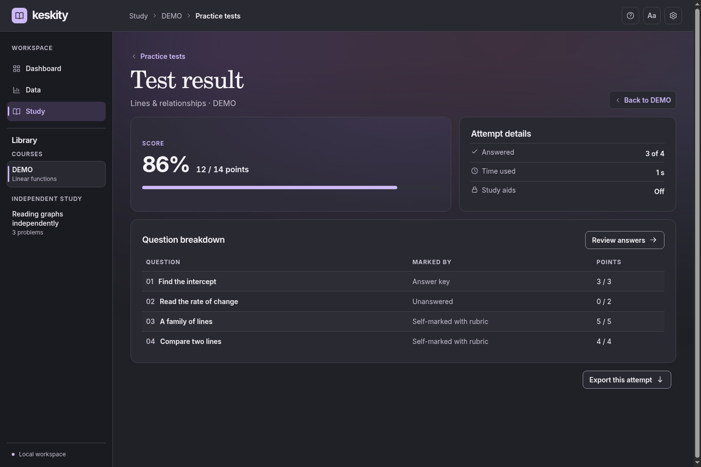

# Build 04 · Timed practice tests

Screenshots from the fictional **Lines & relationships** test, captured in the running app.

| Stage | White · Violet | Graphite |
| --- | --- | --- |
| Before starting | [](setup-light.jpg) | [](setup-dark.jpg) |
| During the test | [](running-light.jpg) | [](running-dark.jpg) |
| Finish confirmation | [Unanswered question warning](finish-light.jpg) | [Countdown continues in the dialog](finish-dark.jpg) |
| Result | [](result-light.jpg) | [](result-dark.jpg) |

[Mobile test view](mobile.jpg) · [Result with provisional model marks](provisional-light.jpg) · [Approved visual drafts](../drafts/v4/README.md)

## Try it

```sh
python3 -B hub.py serve --demo --port 8767
```

Open [http://127.0.0.1:8767](http://127.0.0.1:8767) and choose **Study → Practice tests → Lines & relationships**. The demo uses temporary study records and works without a grader.

- **Before starting:** See the time limit, question count, and points. Choose any permitted aids; they start off and stay fixed during the attempt. A required figure appears even with aids off.
- **During the test:** The question strip shows which answers have saved. Reload to return to your question without resetting the countdown. At zero, only answers saved before the deadline count. If you finish early, the app lists the unanswered questions before you confirm.
- **After submission:** Choice answers use the key. Review written answers against the point rubric, or ask the optional local model to mark an eligible answer. The result shows which marks are **Provisional**. Pending answers do not count as wrong. A course grade appears only when the pack defines a scale.
- **Review:** Reopen a result under **Previous attempts**. Export that attempt if you want to discuss it with Pi. Nothing writes back to Obsidian.

See [PACKS.md](../../PACKS.md#timed-practice-test-editions) for the test-pack format.
