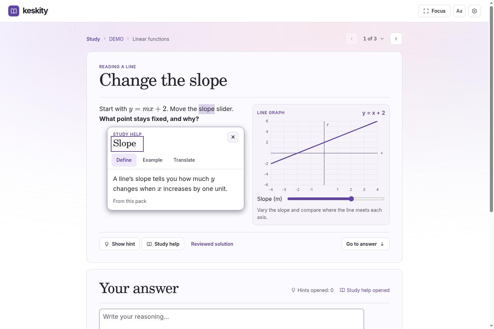
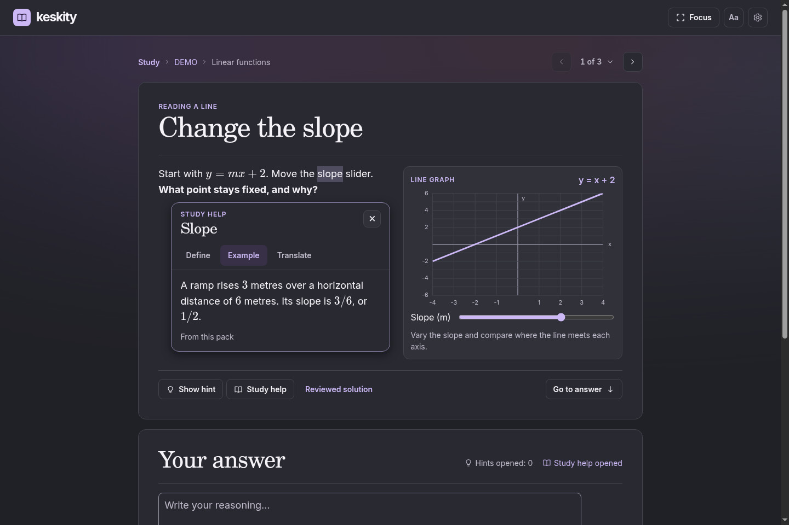

# Build 05 · Inline study help

Live captures from **Change the slope** in the fictional **Linear functions** pack.

| White · Violet | Graphite |
| --- | --- |
| [](definition-light.jpg) | [](example-dark.jpg) |
| [Selection before opening any help](selection-light.jpg) | [Term entry on a narrow screen](mobile-dark.jpg) |

## Try it

```sh
python3 -B hub.py serve --demo --port 8767
```

Open [the demo](http://127.0.0.1:8767) and choose **Study → DEMO → Change the slope**. Select **slope** in the question and choose **Study help**. Or open **Study help** below the question and choose a term with the keyboard or by touch. Select **Define**, **Example**, or **Translate** when provided by the pack. Press **Escape** to close the help.

- Only questions with reviewed entries show this feature. Help is local and works without a model. Timed tests do not offer it.
- Selecting text or viewing the term list does not record exposure. Opening a note marks **Study help opened** in the answer area. Subsequent attempts can include that exposure in a selected export. Selections and lookup histories aren’t stored, and nothing writes back to Obsidian.

[Author a reviewed entry](../../PACKS.md#reviewed-inline-study-help) · [Original inline help draft](../drafts/v4/14-book-inline-help-light.png)
