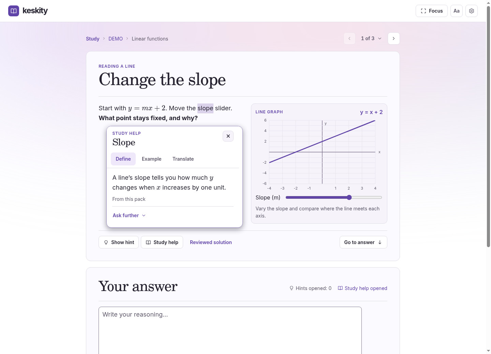
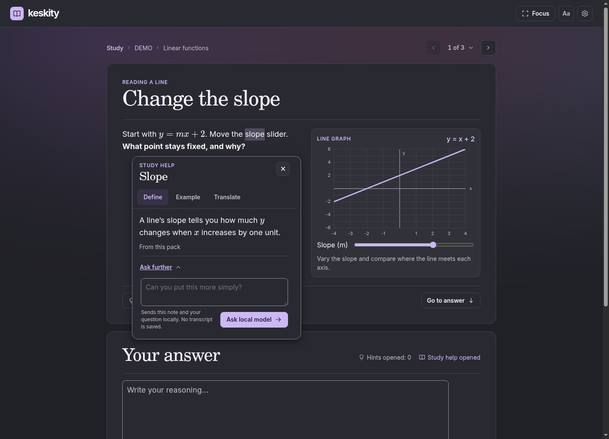

# Build 06 · Ask further

Live captures from **Change the slope** in the fictional **Linear functions** pack, using the existing local Qwen3 model.

| White · Violet | Graphite |
| --- | --- |
| [](entry-light.jpg) | [](compose-dark.jpg) |
| [Generated reply under the composer](reply-light.jpg) | [Narrow-screen Study help (Chromium emulation)](mobile-dark.jpg) |

## Try it

Run these from the project directory in separate terminals:

```sh
sh start-grader.sh
```

```sh
python3 -B hub.py serve --demo --port 8767 --grader-port 8766
```

On the computer running the app, open [the demo](http://127.0.0.1:8767) and go to **Study → DEMO → Change the slope**. Select **slope** in the question, or use **Study help** below it. In **Define**, choose **Ask further**, enter “What does ‘one unit’ mean here?”, then choose **Ask local model**.

## What changes

- **Same panel.** Ask further expands below the note and keeps its heading and tabs in place. Submit to see the reply below the composer. Collapse and reopen within the same note to return to the question; dismissing Study help or switching notes clears it. On narrow screens the existing dialog expands in place. Keyboard activation and reduced-motion settings skip the expansion animation.
- **One note, one question.** The Python backend passes the reviewed note and your question to the existing loopback `llama.cpp` service. It doesn’t attach the exercise, answer key, drafts, attempts, or vault contents. The app does not save the conversation.
- **Reviewed text stays separate.** The note comes from the pack. Qwen3 generates the **Unreviewed** reply on demand. The model is instructed to clarify the note, not solve the exercise. It can still make mistakes; use the reviewed note if they disagree.
- **Optional.** Pack authors [allow follow-ups per note](../../PACKS.md#optional-local-follow-ups). Reviewed help works without the model. Ask further is for untimed practice on the host computer, not timed tests or the LAN demo.

If the app can’t reach the model, check that `sh start-grader.sh` is still running and that its port matches `--grader-port`. You can return to the reviewed note without submitting anything.

[How the local model works and how to add another action](../../MODEL.md)
