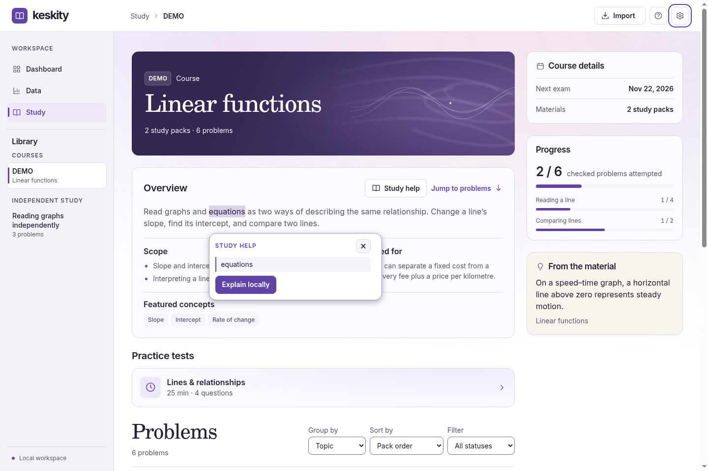
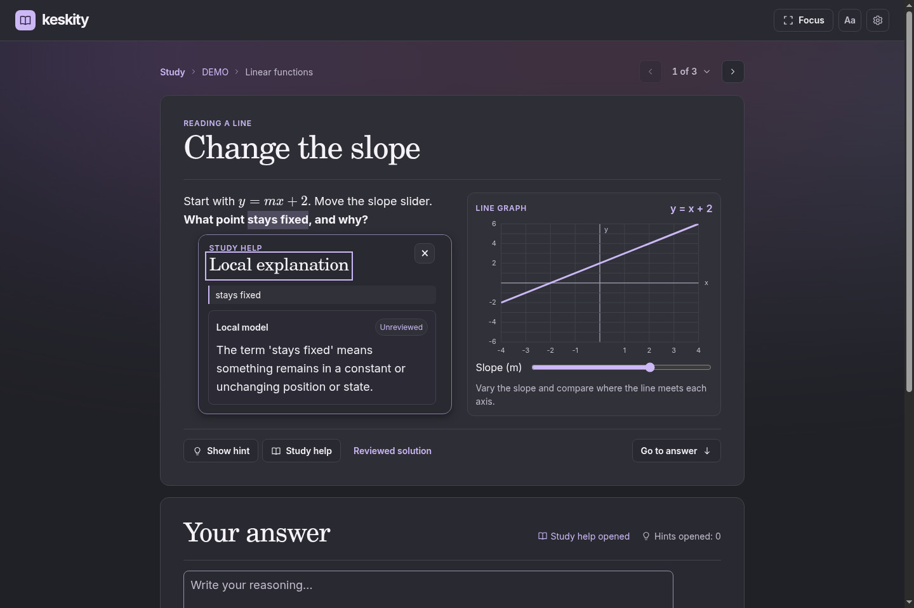

# Build 07 · Explain selected text

| Course overview · White · Violet | Untimed problem · Graphite |
| --- | --- |
| [](selection-light.jpg) | [](problem-dark.jpg) |
| [Generated explanation in the same menu](overview-light.jpg) | [Narrow-screen result from the passage picker](mobile-dark.jpg) |

[Reviewed note and local explanation offered together](reviewed-light.jpg) · [Model off](model-off-light.jpg)

## Try it

Run these from the project directory in separate terminals. If the demo is already running, restart the app to load the new Python endpoint; an already-running grader can stay open.

```sh
sh start-grader.sh
```

```sh
python3 -B hub.py serve --demo --port 8767 --grader-port 8766
```

Open [the demo](http://127.0.0.1:8767). In **Study → DEMO**, select **equations** in the overview, then choose **Explain locally**. In **Change the slope**, try **stays fixed** for a phrase with no prewritten note, or **slope** to see both help options. The **Study help** button also opens a passage picker you can use with the keyboard.

- Selecting text opens the menu without calling Qwen3. A matching **Reviewed note** keeps its authored content and tabs. **Explain locally** generates a separate, **Unreviewed** reply on request.
- Course and independent-study overviews don’t need authored definitions. A checked, untimed problem must [opt in once](../../PACKS.md#local-explanations-for-selections) to allow generated explanations for its visible text. Older packs keep their existing help policy. Timed tests and the LAN demo don’t offer this model action.
- Keskity doesn’t save the selection or generated text. For an untimed problem, a returned explanation records the same local help exposure as opening a reviewed note.

[Model tool and context rules](../../MODEL.md#explain-selection)
