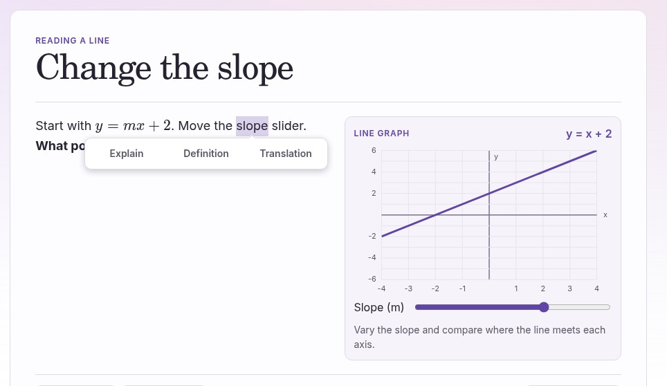
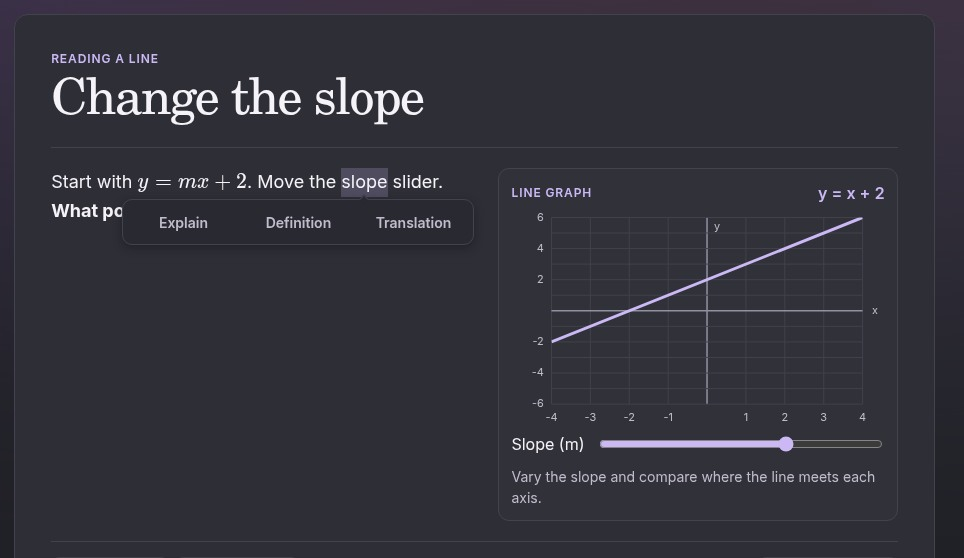

# Build 08 · Compact Study help

Live captures from the fictional **Linear functions** pack. [Approved layout draft](../drafts/compact-study-help/README.md)

| White · Violet | Graphite |
| --- | --- |
| [](tabs-light.jpg) | [](tabs-dark.jpg) |
| [Provided definition with Example and Ask further](definition-light.jpg) | [Pack translation and a separate local translation](translation-dark.jpg) |
| [Copy-only prompt preview](copy-light.jpg) | [Narrow screen with the tabs still visible while the body scrolls](mobile-dark.jpg) |

[Local question field](local-explain-light.jpg) · [Unreviewed explanation](explanation-dark.jpg) · [Model off](model-off-light.jpg)

## Try it

Run from the project directory. For local generation, start `sh start-grader.sh` in a separate terminal if the grader isn’t already running.

```sh
python3 -B hub.py serve --demo --port 8767 --grader-port 8766
```

Omit `--grader-port 8766` to try it without a model. If the old demo is still running, stop it first or use a different port. Restarting a demo discards its temporary records.

1. In **Study → DEMO → Change the slope**, select **slope** in the question. Choose **Definition → Provided definition**. **Example** and **Ask further**, when enabled for that note, open in the same popup.
2. Try **Translation** for the pack’s Finnish note, or open **Translate locally**, pick a language, and press **Translate**. The app remembers the last target language.
3. Select **equations** in the **DEMO** overview. Under **Explain**, try **Explain locally** with or without a question, or preview and copy a prompt. The optional overview context starts unchecked.

Use **Study help** to pick a reviewed term or passage without selecting on the page. Press **Esc** or click outside to dismiss the anchored popup.

## Behavior

- The menu opens beside the highlight with just **Explain · Definition · Translation**. The row stays visible while the capped body scrolls.
- Pointer opening uses a 150 ms fade and slight scale from the highlight. The sections use a reversible 180 ms expansion. Keyboard activation and reduced-motion settings skip these transitions.
- Selecting or switching tabs doesn’t call the model or open a pack note. Opening a provided note is a separate action. Generated results are **Unreviewed**; reviewed notes and clipboard prompts work without a model.
- [Pack permissions and timed-test restrictions](../../PACKS.md#local-explanations-for-selections) still apply. The app doesn’t retain selected text, questions, or generated replies. **Check online** is a placeholder and sends nothing.

[Model inputs and privacy](../../MODEL.md#explain-selection)
