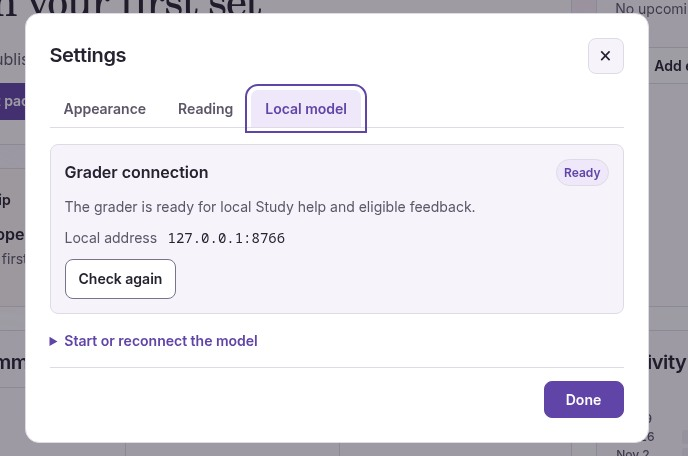

# Build 10 · Local model readiness

| White · Violet | Graphite |
| --- | --- |
| [](ready-light.jpg) | [Starting](starting-dark.jpg) · [Unavailable on a narrow screen](unavailable-mobile-dark.jpg) |
| [Model off](off-light.jpg) | |

**Ready** was captured with the running Qwen3 server. The Starting and Unavailable previews use simulated grader responses. The narrow view is from Chromium emulation.

## Try it

Open [the local demo](http://127.0.0.1:8770/) and choose **Settings → Local model**. **Check again** refreshes the connection status without sending a question to the model. The setup instructions use the configured port when one is set. Other Settings panels and active timed tests don’t make this check.

To run the demo yourself, start `sh start-grader.sh` in a separate terminal if the grader isn’t running, then:

```sh
python3 -B hub.py serve --demo --port 8770 --grader-port 8766
```

Omit `--grader-port 8766` to see **Off**. If you already have keskity running, restart the app or use a new port to load the Python change. The panel doesn’t launch the grader or change its configuration.

## Try your first real pack

Follow the [authoring handoff](../../PACKS.md#first-pack-author-check-import) in a separate Pi chat. The installed exporter and keskity import were tested together with a fictional pack, including a declared image. This checks compatibility, not the quality of a real pack.

Use **Import** in your existing regular workspace. If you want to keep the pilot separate and try Qwen3 as well, use a new data folder and port:

```sh
cd ~/Projects/study-hub
python3 -B hub.py --data-dir "$HOME/.local/share/keskity-pilot" serve --port 8771 --grader-port 8766
```

Open [the pilot workspace](http://127.0.0.1:8771/) after starting it. Omit the grader flag if you want to start without model help. Pick the published folder, not the authoring folder. The app doesn’t write back to it or to your vault.
